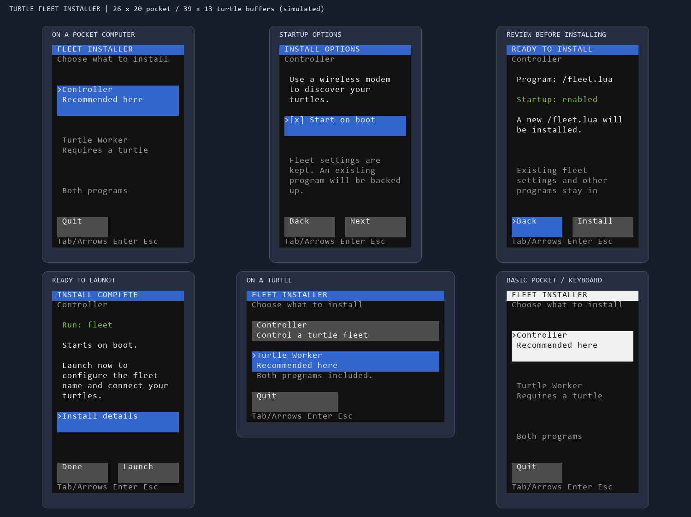
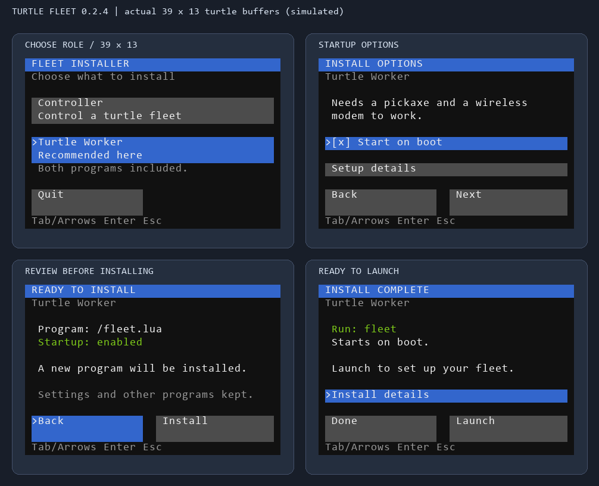
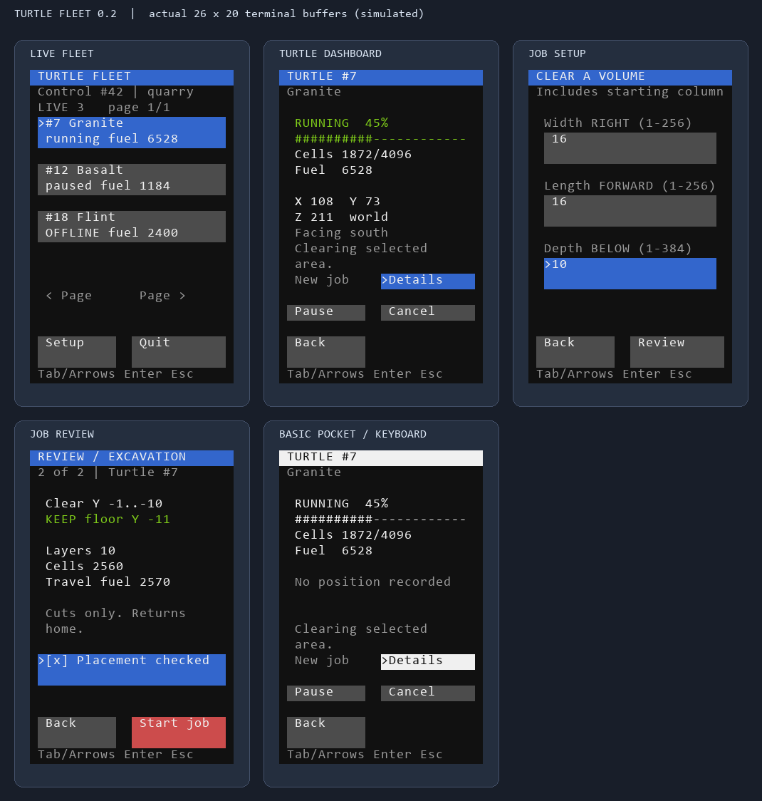

# Orbit OS and Turtle Fleet

**Orbit OS 0.4.0:** a light desktop with a searchable app library, a dock, movable/resizable windows, and layouts that adapt to computers and pockets. Use the standalone [`install-os.lua`](install-os.lua), or **Updates → Update everything** in Orbit. Turtle Fleet, wired/wireless monitor casting, and controller-managed worker updates are included. The default update source is this repository's `main/dist/orbit-release` directory; see the [Orbit guide](docs/ORBIT.md). Older workers need one initial installation of the current worker before receiving remote updates. The Fleet-only installer below remains available for turtle workers and standalone controllers.

In-game Lua programs for discovering and controlling CC:Tweaked mining turtles from a regular or pocket computer. Version **0.3.1** targets the public APIs in **CC:Tweaked 1.120.3 for Minecraft 26.3**. The Lua package does not depend on a mod loader.

**Download/copy:** [`install.lua`](install.lua) at the top level of this project is the complete, ready-to-run Fleet installer. An identical copy is in [`dist/`](dist/). Local builds also produce `dist/turtle-fleet.zip` for offline transfer. No Python or additional Lua libraries are needed in Minecraft.

Optional **[Orbit Display companion](companion/README.md)**: change desktop and pocket resolutions from Settings, with automatic screen fitting and a 15-second preview/revert timer. Requires Fabric on Minecraft 26.3; the Lua OS also works without it.

## What works

- A GUI designed for the pocket computer's 26×20 screen, with clickable buttons on advanced pockets and complete keyboard controls on basic models.
- Automatic discovery and a paginated live list of turtles, including offline status, stable selection, and mouse-wheel paging.
- A live turtle dashboard with progress, fuel, position, and Pause/Resume controls.
- Short setup pages, editable fields, Back/Next navigation, validation, and a two-page job review; nothing scrolls off the display.
- Two selectable mining programs: **Flatten by corners** and **Clear width/length/depth**.
- Inclusive rectangle boundaries, an explicit start position, and a preview before digging.
- Top-down excavation followed by return to the starting block and original facing.
- Progress, position, fuel, pause, resume, and cancel.
- A turtle accepts commands only from its configured controller ID.
- Stops for low fuel, nearly full cargo, fluids, common protected blocks, entities, and unbreakable blocks.
- Stacks mined items and consolidates compatible cargo stacks before reporting a full inventory.
- Automatic pause after 12 seconds without contact from the controller. Reconnection requires Resume.
- Remote worker updates from Orbit: idle workers update immediately; busy workers wait for their job to finish. Downloads are verified, settings preserved, and the previous worker kept as a backup.

This version **cuts material away**. It does not fill holes, place a floor, scan distant terrain, unload into a chest automatically, or coordinate overlapping jobs between turtles.

## Equipment

On the controller, use a regular/advanced computer with an attached wireless modem, or a regular/advanced pocket computer with a wireless modem upgrade. On each turtle, equip a **diamond pickaxe** and a **wireless or Ender modem**. Put fuel in **slot 16** and leave slots **1–15** for cargo.

The worker finds the modem by peripheral type, including a pocket computer's `top` slot. GPS is optional; it can check a manually entered starting position if GPS hosts are available. Facing is always supplied by you, because a GPS position alone does not determine orientation.

## Install

1. Copy **only [`install.lua`](install.lua) from the top level of this project** into the computer's filesystem or onto a floppy disk. Both programs are embedded in this one file; no companion files or internet connection are needed.
2. Run `install` (or `disk/install` from a disk). Choose **Controller** or **Turtle Worker**. The installer recommends Controller on computers and pockets, or Turtle Worker on turtles. Worker installation is unavailable on computers.
3. Choose whether to **Start on boot**, select **Next**, then **Install** on the review screen. Select **Launch**, or run `fleet` later. All screens fit a pocket computer and support clicks on advanced devices or **Tab/arrows** and **Enter** on basic devices.
4. Set up the controller first: choose a fleet name, such as `quarry`, and note the controller ID shown on screen. On each turtle, use the same installer, launch the worker, and enter the **same fleet name** and that **controller ID**.
5. Turtles appear automatically in the controller's list. Select one, choose **New job**, then select a program.

The installer writes `/fleet.lua` and optionally `/startup/fleet.lua`. It preserves fleet settings and backs up an existing program as `/fleet.lua.backup`, adding a numbered suffix when needed. It verifies staged writes and attempts to restore the previous files if installation fails. Backups are retained after successful updates. A power interruption during installation can still require restoring that backup manually.

Custom startup files are preserved. If `/startup` is a file, or `/startup/fleet.lua` already contains another program, the installer explains the conflict and defaults to manual launch. Turning off **Start on boot** removes only a launcher recognized as belonging to Fleet. If you already launch Fleet from another startup script, keep this option off to avoid starting it twice.

Optional shortcuts preselect a role while retaining the GUI review: `install auto`, `install controller startup`, or `install worker manual`. You can also copy and run `fleet-controller.lua` or `fleet-worker.lua` directly; each release file includes all its modules.

For local single-player file transfer, the computer's files are under the world's `computercraft/computer/<computer-id>/` directory. Use the in-game `id` command to find the ID and the correct save/instance folder. Copy the release files there while that computer is shut down. On a remote server, use its permitted file-transfer method or a prepared in-game disk; your local save folder will not control server computers.

The controller's **Setup** button changes the fleet name. To change a worker's fleet or assigned controller, stop Fleet with **Ctrl+T**, then run `fleet setup` (or the direct release filename followed by `setup`). To update, finish or cancel the current job, stop Fleet, copy the new `install.lua`, and run the installer again. Restarting the worker discards its active job. Existing 0.1 workers remain compatible with the controller GUI, but worker fixes require updating each turtle.

### Fix for stopping after 14 blocks (0.2.4)

Earlier workers selected a new empty cargo slot before every dig, spreading identical drops into separate slots. Version 0.2.4 starts collection at slot 1 and merges compatible stacks in slots 1–15 when space runs low. Stack limits and item variants are respected; consolidation never touches slot 16 or drops items. The two-empty-slot reserve still applies after consolidation.

For a job already blocked by this bug, manually combine the dirt into one stack or unload cargo, then press **Resume** on the controller. The old worker may spread subsequent drops out again. Finish or cancel that job before installing **Turtle Worker** from the new `install.lua`; starting the updated worker does not recover the old job. Controller and Orbit installations do not need updating for this fix, and Orbit's updater does not deploy worker updates to turtles.



The installer adapts to **39×13 turtle terminals**, 26×20 pocket computers, and 51×19 computers. Short screens use compact buttons and a **Setup details** or **Startup notice** button for longer explanations. All installer pages, including errors, review, and Launch, support displays at least 26 columns by 13 rows. The controller dashboard still requires 26×19 or larger; use a computer or pocket for that role.



If an older installer says **Display too small** on a turtle, replace its `install.lua` with this release and run `install` again. No display settings need changing.

### If you see `module 'fleet.payloads' not found`

This means the computer is running the development source entry point. `fleet.payloads` is generated and embedded during packaging; copying the whole `src/` folder cannot supply it. Replace the computer's `/install.lua` with the ready-to-run [`install.lua`](install.lua) from the top level of this project (or the identical `dist/install.lua`), then run `install` again. You can leave the other copied files in place. The complete file starts with `-- Turtle Fleet 0.2.4`. The source entry point is now named `src/installer_main.lua` to distinguish it from the installer.

## Pocket GUI



The controller GUI uses CC:Tweaked's terminal graphics and color blocks. Mouse events are available on **advanced** pocket computers; basic pocket computers use the same screens with grayscale styling and keyboard focus markers. It supports 26×20 pockets and 51×19 desktop terminals. Larger screens center the interface; smaller than 26×19 shows a resize message and disables hidden controls. The installer has its own compact layout for shorter turtle terminals.

| Input | Action |
| --- | --- |
| Left click | Activate a button or focus an input field on an advanced computer |
| Mouse wheel | Change pages in the turtle list |
| Tab / Shift+Tab | Move forward/backward through enabled controls |
| Up / Down | Move focus between controls |
| Enter / Space | Activate the focused button; Enter advances from an input field |
| Escape | Back; on the fleet list, open the quit confirmation |
| Left / Right, Home / End | Move the cursor within an input field |
| Backspace / Delete | Edit a field |
| Ctrl+U | Clear the focused field |
| Paste | Insert text at the field's cursor |

Status updates never erase typed values, move the editing cursor, or change the focused turtle when another turtle appears. Back keeps the current wizard's values. Discovery and heartbeats keep running during setup, review, and command retries. Disabled actions cannot be selected or clicked. Long reasons and validation errors open a paginated message view.

## The starting position matters

**Place the turtle at a corner of the footprint, one block ABOVE the highest layer you want removed.** Its starting block belongs to the column at that corner. Keep the starting-Y plane above the entire footprint clear so the turtle can return home.

For example, to remove a hill down to a floor at **Y=64**, with its highest block at **Y=80**, place the turtle at **Y=81**. It clears **Y=80 through Y=65** and leaves **Y=64** untouched.

```text
Side view:
Y=81    T . . . .   <- turtle start / clear return plane
Y=80    # # . . .   <- first layer to remove
  ...   # # # # #
Y=65    # # # # #   <- last layer to remove
Y=64    = = = = =   <- floor: never dug
```

The turtle does not determine the highest terrain automatically. Choose a height above trees, buildings, or overhangs that should be cleared too. Blocks above the selected top layer are outside the job, and gravity or fluids can change the area after a turtle passes. Prepare unstable material or flowing fluids before running an unattended job.

**Use the turtle block's position**, not the player's standing position. In world-coordinate mode, enter its actual X/Y/Z and cardinal facing. Minecraft axes are north = −Z, east = +X, south = +Z, west = −X. Do not move or turn the turtle manually while a job is active or paused.

### Program 1: Flatten by corners

Enter two opposite **X/Z** corners and the **floor Y to keep**. The corners are inclusive. The turtle may start above **any of the four corners**, and the order of the two entered corners does not matter. It must already be at the corner; Fleet does not navigate to a job from elsewhere.

Example:

| Input | Value |
| --- | --- |
| Turtle start | X=100, Y=81, Z=200 |
| Facing | Its actual direction, for example north |
| Corner 1 | X=100, Z=200 |
| Corner 2 | X=115, Z=215 |
| Floor to keep | Y=64 |
| Result | 16 × 16 footprint, 16 removed layers, 4,096 cells |

There is no separate Y value for each corner: the horizontal footprint comes from X/Z, the top comes from the turtle's starting Y, and the bottom comes from the floor Y.

### Program 2: Clear width/length/depth

Choose relative mode for a job with no GPS or world coordinates. The turtle's starting block is local `(0,0,0)`. **Width extends right; length extends forward; depth counts layers below the turtle.** Width and length include the starting column.

```text
Top view (turtle initially faces up):

       forward / length
          ^
          |  + + + +
          |  + + + +
          |  + + + +
             T + + +  -> right / width
```

For a **16 × 16 × 10** job, place the turtle one block above the top at the back-left corner of the footprint, facing into it. It removes ten layers below its starting Y. If the turtle is actually at Y=81, it clears Y=80 through Y=71 and leaves Y=70 untouched. In local mode the display instead shows removal from Y=−1 through Y=−10, with floor Y=−11.

World mode for this program uses the same orientation rules and can optionally verify the starting location with GPS.

## Operating a job

Select a turtle to see live progress and these buttons:

| Button | Action |
| --- | --- |
| New job | Pick a program and review a new job |
| Pause / Resume | Pause before the next physical action, or resume after correcting a blocking condition |
| Cancel | Confirm cancellation and stop in place; this does **not** return home |
| Details | Read the full turtle name, status, reason, position and owner |
| Back | Return to the turtle list |

The two review pages show bounds, start position, layers, floor, volume, and travel fuel. Select **Placement checked** to enable **Start job**, then click it or focus it and press Enter. Leaving the final review resets this check. If the turtle restarts or its job changes during setup, the reviewed job cannot be submitted. Fuel is the planned movement cost, including the return trip. It is not an upfront fuel requirement: a large job can pause for more fuel along the way.

- **Inventory:** the turtle consolidates compatible stacks if fewer than two cargo slots are empty, then pauses before digging if that reserve is still unavailable. Unload it **where it stopped**, then Resume. It never drops cargo automatically. Multiple-drop blocks or other mods can still overflow inventory; the empty-slot reserve is a practical buffer, not a guarantee for arbitrary loot.
- **Fuel:** add usable fuel to slot 16, then Resume. Fleet consumes only slot 16 as needed and does not deliberately burn mined cargo. Keep fuel stocked there; an empty slot 16 can receive mining drops just like any other inventory slot.
- **Obstructions:** clear the obstruction and Resume, or Cancel. A completed excavation may be blocked on its return path; the turtle will wait instead of digging outside the job.
- **Radio:** stay in modem range and keep the controller running. The list marks a turtle offline after eight seconds without status; the worker pauses after twelve seconds without controller contact. Ender modems remove the distance limitation when used appropriately.
- **Pause/cancel timing:** a physical API call already in progress can finish before the stop takes effect. An acknowledgement means the command was accepted; check the subsequent status for the resulting state.
- **Restart:** jobs do not resume after a computer/server restart or worker termination. An interrupted-job marker is reported, but there is no durable movement journal. Verify the turtle's current position and create a new job. Do not reuse the original start pose unless the turtle is back there.

Limits are 256 blocks per horizontal edge, 384 removed layers, and 2,000,000 cells per job. The chosen area must also fit the dimension's actual world borders and build-height range. Keep working chunks loaded and assign separate, non-overlapping areas to different turtles.

Fleet blocks digging into CC:Tweaked blocks, chests, barrels, shulker boxes, and spawners. This is not a universal claim-protection system for every modded block. The fleet name and controller ID prevent accidental cross-control; **Rednet does not authenticate sender IDs or encrypt messages**, so this version assumes trusted players on the network.

## Development and verification

Edit `src/`, then rebuild the self-contained releases:

```sh
python -m pip install --target .tools -r requirements-dev.txt
python tools/build.py
python tools/test.py
```

All **121 test groups** pass across Fleet and Orbit. The harness uses Lua 5.2 via Lupa, compiles source and bundled programs, and simulates geometry, digging, inventory, fuel, obstructions, GPS verification, command retries, ownership, and connection loss. Inventory tests model selected-slot insertion and cover a 525-block dirt excavation, fragmented stacks, item variants, stack limits, failed transfers, and cancellation during consolidation. The route suite exercises 480 size/facing combinations plus full simulated excavations from all rectangle corners. Orbit adds window management, casting, one-button OS/app/worker updates, persistent sources, verification, rollback, and release-bundle integration tests. Worker update tests cover ownership, session checks, busy jobs, duplicate/out-of-order packets, lost acknowledgements, timeouts, cancellation, invalid Lua, checksum failure, disk recovery and reconnect confirmation.

GUI tests use a strict terminal buffer that rejects out-of-bounds writes, overlapping controls, clipped button labels, and non-grayscale colors on basic computers. They cover both job modes, editing, pagination, stale status, preserved focus, resizing, keyboard input, and clicks at 26×19, 26×20 and 51×19. Separate event simulations load the release bundles and complete discovery, job setup, acknowledgement, excavation, and return using both mouse and keyboard workflows. **Live Minecraft 26.3 validation confirmed GitHub OS/app updates, a controller-to-worker update from Fleet 0.3.0 to 0.3.1, worker restart/version confirmation, retained settings and backups, plus window dragging/resizing.** The installed files matched the published SHA-256 hashes. This did not exercise every mining or network failure scenario in-game.

Installer tests cover role detection, mouse and keyboard workflows at 39×13, 26×20, 51×19 and additional compact sizes, startup conflicts, backups, insufficient space, read-only filesystems, failed writes and moves, verification, and rollback. Both roles are also installed by running the actual standalone root `install.lua` and `dist/install.lua` with no companion files, then comparing the result with the corresponding release bundle. The turtle release tests use the actual 39×13 screen size, including keyboard and mouse installs. Running the source entry point without generated payloads gives instructions for finding the complete installer.

To regenerate the visual previews from the real GUI renderer, install Pillow in your development Python environment and run `python tools/preview.py` and `python tools/preview_installer.py`. The previews use a desktop monospace font to display the actual character and color buffers; they are not in-game screenshots.

Suggested first in-game trial: a 3 × 3 × 2 dirt area, with the turtle at a corner above it, some coal in slot 16, and empty cargo slots. Verify its footprint and retained floor, then run again to exercise Pause/Resume. Check Cancel and a controller shutdown in a separate small trial before a large excavation.

Source layout:

| File | Purpose |
| --- | --- |
| `src/installer_main.lua` | Development installer entry point; build embeds both programs into root `install.lua` and `dist/install.lua` |
| `src/fleet/installer.lua` | Pocket-sized installer GUI and role selection |
| `src/fleet/install_core.lua` | Installation checks, verified writes, backups and recovery |
| `src/controller.lua` | Controller startup and event loop |
| `src/fleet/gui.lua` | Cell renderer, buttons, editable fields, mouse and keyboard focus |
| `src/fleet/dashboard.lua` | Live list, turtle dashboard, setup wizard, review screens |
| `src/fleet/client.lua` | Discovery, heartbeats and asynchronous command acknowledgements |
| `src/worker.lua` | Turtle setup and concurrent network, execution, and display loops |
| `src/fleet/planner.lua` | Program registry, validation, coordinate geometry, route generation |
| `src/fleet/motion.lua` | Checked movement, digging, cargo and fuel handling |
| `src/fleet/engine.lua` | Job lifecycle, controls, connection lease, replay handling |
| `src/fleet/net.lua` | Modem discovery and protocol envelope |
| `src/fleet/ui.lua` | Shared prompts and configuration files |
| `tests/` | Simulated turtle and regression tests |

## API references

- [CC:Tweaked 26.3 / 1.120.3 release](https://github.com/cc-tweaked/CC-Tweaked/releases/tag/v26.3-1.120.3)
- [Turtle movement, tools, inventory, inspection and fuel](https://tweaked.cc/module/turtle.html)
- [Rednet and its security model](https://tweaked.cc/module/rednet.html)
- [Wireless and Ender modem behavior](https://tweaked.cc/peripheral/modem.html)
- [GPS position lookup](https://tweaked.cc/module/gps.html)
- [Startup programs](https://tweaked.cc/guide/startup.html)
- [Mouse events on advanced computers](https://tweaked.cc/event/mouse_click.html)
- [Terminal graphics](https://tweaked.cc/module/term.html)
